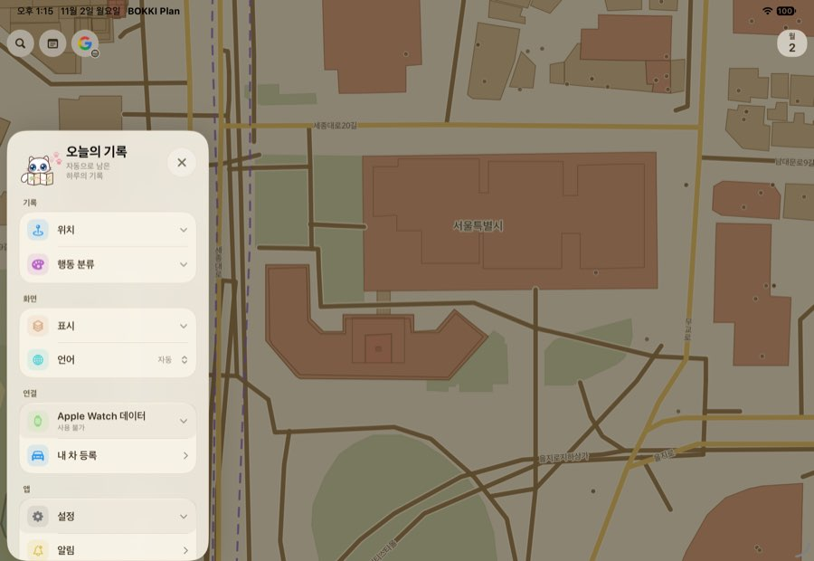
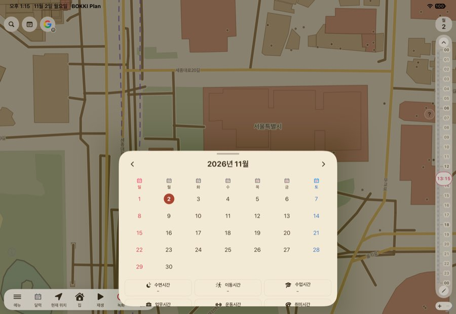
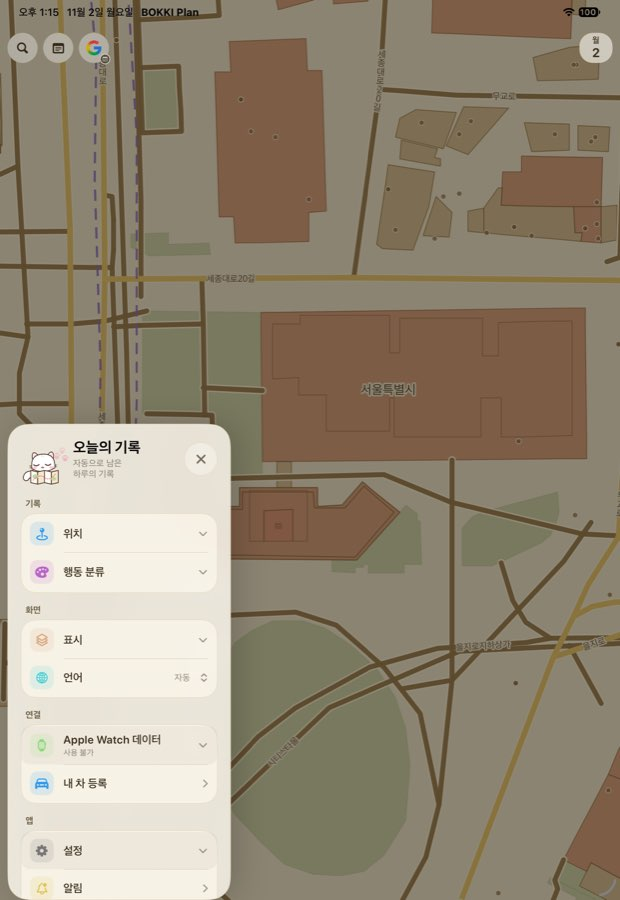
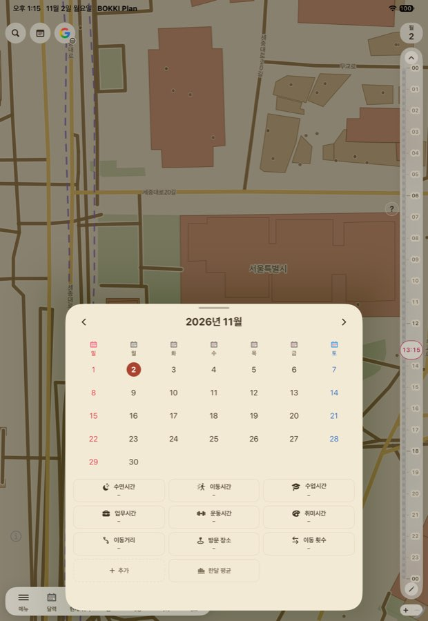

# 아이패드 화면 구성 (IPD1102A01)

폭 600pt 이상(`MapHomeWideLayoutPolicy.isWide`)에서만 적용합니다. 아이폰과 듀오 바깥 화면(466pt)은 그대로입니다.

## 지금 화면 (빌드 257~258, 시뮬레이터)

| 메뉴 · 가로 | 달력 · 가로 | 메뉴 · 세로 | 달력 · 세로 |
| --- | --- | --- | --- |
|  |  |  |  |

- 메뉴가 지도를 어둡게 덮고 시간 사이드바와 하단 메뉴를 숨깁니다.
- 달력·하루 요약·하루 카드는 아래에서 올라오는 시트라 하단 메뉴를 가리고, 가로에서는 아래가 잘립니다.
- 클립 편집은 줄이 화면 폭만큼 늘어나고 도구는 맨 아래에 멉니다.

## 바꿀 구성

왼쪽 하단 알약 메뉴 위쪽을 **패널 자리**로 씁니다. 알약 폭은 그대로(402pt)이고 패널도 같은 폭으로 그 위에 섭니다.

```
┌ 검색·메모·일정 ┬──────────────────┬ 날짜 ┐
├───────────────┤                  │ 사이 │
│  패널          │       지도        │ 드바 │
│  메뉴·달력     │  (패널만큼 줄어듦)  │ (오른│
│  하루 요약     │  계속 만질 수 있음  │ 쪽 세│
│  하루 카드     │                  │ 로   │
├───────────────┤                  │ 전체)│
│ 하단 알약 메뉴  │                  │      │
└───────────────┴──────────────────┴──────┘
```

| 항목 | 넓은 폭 | 근거 |
| --- | --- | --- |
| 메뉴 | 어두운 막 없이 왼쪽 패널. 사이드바·알약 유지 | 지도를 가리지 않는다 |
| 달력·하루 요약·하루 카드 | 같은 자리의 패널. 한 번에 하나, 제목 줄의 닫기 단추 | 알약으로 옮겨 다닐 수 있다 |
| 집 성장 | 하루 요약의 단추에서 뜨는 팝오버 | 패널 위의 잠깐 보는 정보 |
| 달력 | 폭 1050pt 이상이면 패널 680pt, 왼쪽 달·오른쪽 요약 두 열. 그 아래는 402pt 한 열 | 세로 화면은 높이가 넉넉하다 |
| 클립 편집 | 왼쪽 세로 타임라인, 오른쪽 머리말·선택 요약·도구 열 | 줄이 지나치게 늘어나지 않게 |
| 지도 | 패널을 뺀 나머지 폭으로 줄이고 현재 위치 기준점도 옮긴다. 남는 폭이 360pt 미만이면 줄이지 않고 패널을 위에 띄운다 | 분할 화면에서 지도가 사라지지 않게 |
| 사이드바 | 오른쪽 세로 전체 유지, 넓은 폭에서 레일을 조금 넓힌다 | 큰 화면 비율 |
| 알약 메뉴 | 왼쪽 아래, 폭 402pt 유지 | 대표 지시 |

그 밖의 시트(장소·마커·설정 등)는 지금처럼 아이패드 시트로 둡니다.

## 폭별 동작

| 화면 | 폭×높이 | 패널 | 지도 |
| --- | --- | --- | --- |
| 일반 아이폰, 듀오 바깥 | 402~466 | 없음(기존 시트·메뉴) | 전체 |
| 아이패드 절반 분할, 듀오 안쪽 | 600~789 | 402 | 전체(패널이 위에 뜸) |
| 아이패드 세로 | 834×1210 | 402 | 나머지 |
| 아이패드 가로 | 1210×834 | 402, 달력 680 | 나머지 |
